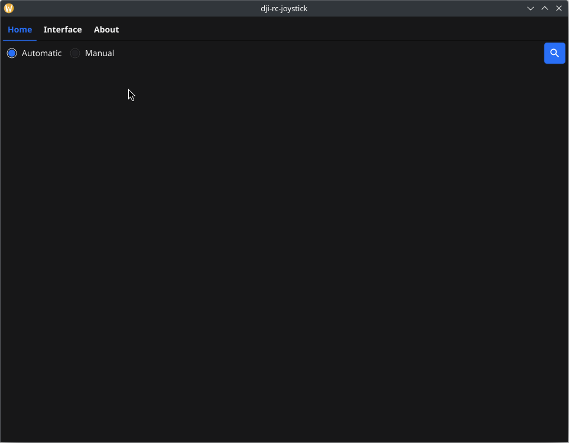
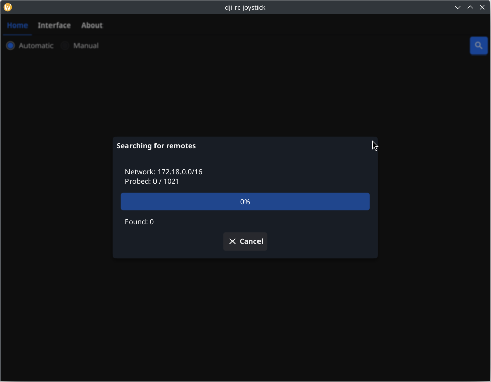
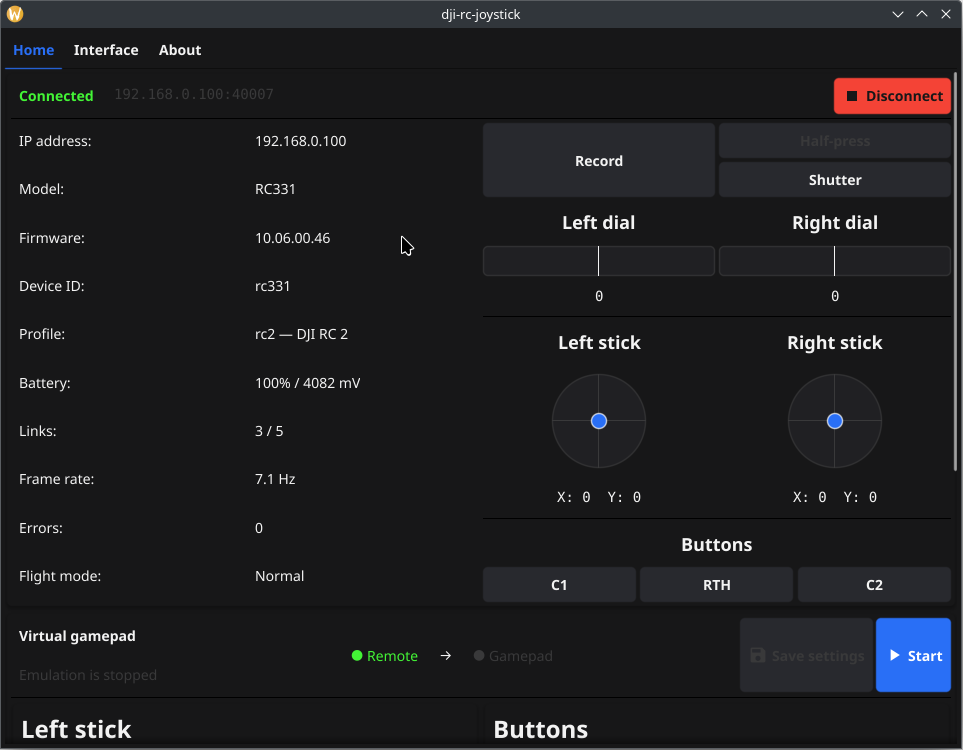
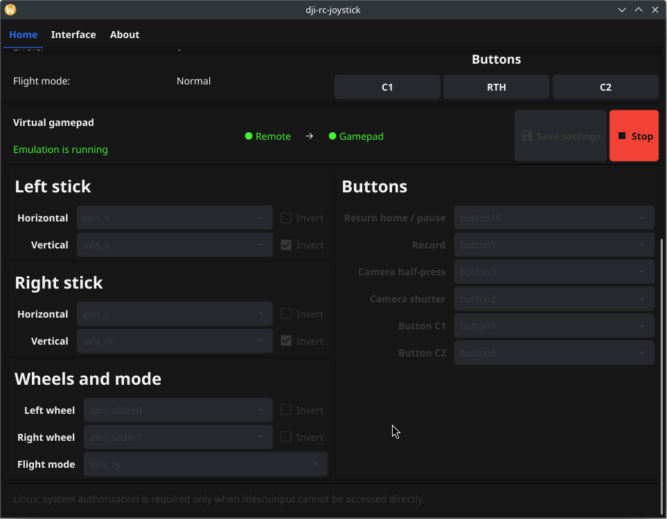

# DJI RC Joystick GUI

DJI RC Joystick is a desktop application for finding a DJI screen remote on the
local network, monitoring its controls, and exposing it as a virtual gamepad.
DJI RC and DJI RC 2 are verified; other models are listed under
[remote compatibility](#remote-compatibility).

## Download and start

Ready-to-run GUI builds for Linux and Windows are available on the
[GitHub Releases page](https://github.com/voluminor/dji-rc-joystick/releases).
GUI asset names start with `gui-`. Download the file for your operating system
and architecture; building the application from source is optional.
On Linux, mark the downloaded file as executable if necessary. Command examples
below use `gui-dji-rc-joystick` as a short name; replace it with the downloaded
filename.

Before connecting, make sure the computer can reach the remote over the local
network. The default DJI data port is TCP `40007`.

1. Start the application.
2. Keep **Automatic** selected and press the search button, or select
   **Manual** and enter the remote address.
3. Choose the discovered remote and wait for the connection to complete.
4. Check the live controls before enabling gamepad emulation.
5. Configure and save the mapping, then press **Start**.



## Connect to a remote

### Automatic discovery

Automatic discovery checks known DJI addresses and eligible local IPv4
networks on TCP port `40007`. The progress dialog shows the network, probe
count, and number of remotes found. You can cancel the scan without closing the
application.



If automatic discovery does not find the remote, select **Manual** and enter
its IPv4 or IPv6 address. Leave the port at its default unless the remote uses a
different one.

### Connection lifecycle

Connection and reconnection run in cancellable dialogs. A temporary outage does
not close an active virtual gamepad: all buttons are released, analog controls
return to neutral, and live output resumes after the remote reconnects.

Pressing **Disconnect** is different from a temporary outage. It ends the remote
session and stops the virtual gamepad.

## Monitor the remote

After connection, the Home tab splits the live view into two columns:

- the left side shows the address, model, firmware, device ID, active profile,
  battery, links, frame rate, error count, and flight mode;
- the right side visualizes camera buttons, dials, sticks, and controller
  buttons.



The display refreshes at no more than 30 Hz. Controller processing is not
limited by the screen refresh rate.

## Configure the virtual gamepad

The virtual-gamepad panel is below the live controller view. It maps:

- horizontal and vertical axes for both sticks;
- left and right wheels;
- the flight-mode switch;
- Return Home, recording, camera, C1, and C2 buttons.

Each control has an action selector. Analog controls also have an **Invert**
option. Values such as `axis_rx` and `button10` are backend identifiers and are
intentionally not translated.

**Save settings** becomes available only when the current mapping differs from
the saved configuration. Start emulation only after saving the mapping. Mapping
controls stay locked while emulation is starting, running, waiting for the
remote, or stopping.

The status row shows the remote and virtual-gamepad states separately. Use
**Start** to create the device and **Stop** to close it.



A short recording of the controller working with a Steam Deck is also
available: [Steam Deck demonstration](../.github/media/steamdeck-rc.mp4).

## Platform support

| Platform        | Ready GUI build   | Discovery and monitoring | Virtual gamepad                          |
|-----------------|-------------------|--------------------------|------------------------------------------|
| Linux           | Yes               | Supported                | Uses `/dev/uinput`                       |
| Windows         | Yes               | Supported                | Requires a configured 64-bit vJoy device |
| macOS           | Build from source | Supported                | Not supported                            |
| Other platforms | Build from source | Platform-dependent       | Not supported                            |

### Linux authorization

The application opens `/dev/uinput` directly when the current user already has
access. If the kernel denies access, it starts the same executable through
`pkexec`; the system Polkit agent displays the authorization dialog and handles
the password. No temporary helper binary is created.

If the application already runs as root, direct access succeeds and no password
dialog appears. Giving a regular user access through an `input` group and a
udev rule avoids running the full GUI as root:

```udev
KERNEL=="uinput", GROUP="input", MODE="0660"
```

If `/dev/uinput` is missing, load the kernel module:

```bash
sudo modprobe uinput
```

### Windows vJoy

Gamepad emulation needs an installed, enabled, and configured 64-bit vJoy
device. The application scans device IDs `1..16` and uses the first compatible
free device. Configure enough axes and buttons for the selected mapping before
pressing **Start**.

The Windows 386 backend cannot create a virtual gamepad. Discovery, connection,
and monitoring remain available.

## Remote compatibility

| Remote                | Status                       |
|-----------------------|------------------------------|
| DJI RC                | Verified                     |
| DJI RC 2              | Verified                     |
| DJI RC Pro            | Expected to work, not tested |
| DJI Smart Controller  | Expected to work, not tested |
| DJI RC Pro Enterprise | Expected to work, not tested |

For untested remotes, discovery, the complete control set, and connection
stability are not guaranteed.

## Interface settings

The **Interface** tab controls:

- light or dark theme;
- text-size multiplier from `0.2` to `8.0`;
- one of 27 supported interface languages.

### Supported interface languages

The GUI includes these 27 left-to-right locales:

| Locale  | Native name        |
|---------|--------------------|
| `bn`    | বাংলা              |
| `cs`    | Čeština            |
| `de`    | Deutsch            |
| `el`    | Ελληνικά           |
| `en`    | English            |
| `es`    | Español            |
| `fil`   | Filipino           |
| `fr`    | Français           |
| `hi`    | हिन्दी             |
| `hu`    | Magyar             |
| `id`    | Bahasa Indonesia   |
| `it`    | Italiano           |
| `ja`    | 日本語                |
| `ko`    | 한국어                |
| `ms`    | Bahasa Melayu      |
| `nl`    | Nederlands         |
| `pl`    | Polski             |
| `pt-BR` | Português (Brasil) |
| `ro`    | Română             |
| `ru-RU` | Русский            |
| `sv`    | Svenska            |
| `th`    | ไทย                |
| `tr`    | Türkçe             |
| `uk-UA` | Українська         |
| `vi`    | Tiếng Việt         |
| `zh-CN` | 简体中文               |
| `zh-TW` | 繁體中文               |

Saving a language change updates the persistent Home view without disconnecting
the remote. The **About** tab shows the application version, source link,
supported remotes, and sorted GUI dependency versions with available license
text.

## Configuration and logs

The GUI stores settings in the platform configuration directory:

| Platform | Default settings file                                         |
|----------|---------------------------------------------------------------|
| Linux    | `~/.config/dji-rc-joystick/settings.json`                     |
| Windows  | `%AppData%\dji-rc-joystick\settings.json`                     |
| macOS    | `~/Library/Application Support/dji-rc-joystick/settings.json` |

Select another file with `--config`:

```bash
gui-dji-rc-joystick --config /path/to/settings.json
```

Configuration files can use `.json`, `.yaml`, or `.yml` and are limited to
1 MiB. If the selected file does not exist, the GUI creates it from the defaults
in the root `settings.yml`. UI changes are validated and written atomically.

Generated settings flags override file values. Run the executable with
`--help` to list them. For example:

```bash
gui-dji-rc-joystick --ui.language ru-RU --ui.dark_mode=false
gui-dji-rc-joystick --logging.file.level debug
```

Logging has independent console and file outputs:

- the console writes colored text to stderr at `info` by default;
- the rotating file writes JSON Lines at `error` by default.

The default log file is
`<settings-directory>/logs/dji-rc-joystick.log`. Available levels are `trace`,
`debug`, `info`, `warn`, `error`, `fatal`, and `panic`. Trace records include
every accepted decoded controller state and can therefore grow quickly.

Fyne messages use the same logger with `component=fyne` and
`source=standard_log`. A privileged Linux helper sends bounded structured
records back to the parent process, so it does not open or compete for the GUI
log file.

## Troubleshooting

### No remote is found

1. Confirm that the computer and remote can reach each other.
2. Check that a firewall does not block TCP port `40007`.
3. Try **Manual** mode with the remote's address.
4. Check the log file for discovery or connection errors.

### Emulation does not start on Linux

Check that `/dev/uinput` exists. If direct access is denied, complete the Polkit
dialog or configure persistent access with the udev rule above.

### Emulation does not start on Windows

Confirm that 64-bit vJoy is installed, its driver is enabled, and at least one
compatible device is free. The device must expose every axis and button used by
the saved mapping.

### Controls return to neutral

This is expected while every remote link is temporarily offline. The virtual
device stays open and resumes output after reconnection. Pressing
**Disconnect** stops it completely.

## Build from source

Source builds require Go 1.26 or newer, CGO, and a C compiler. On Debian or
Ubuntu, install the OpenGL, X11, and Mesa development packages required by Fyne,
including `libgl1-mesa-dev` and `xorg-dev`.

Generate the shared packages before the first build and after changing any
`go.mod`:

```bash
(cd .. && go generate .)
```

From the `gui` directory, run the application:

```bash
CGO_ENABLED=1 go run .
```

Build a local executable in the repository's ignored `tmp` directory:

```bash
mkdir -p ../tmp
CGO_ENABLED=1 go build -o ../tmp/gui-dji-rc-joystick .
../tmp/gui-dji-rc-joystick
```

Generation writes `target/gui/dependencies_gen.go` from `gui/go.mod`. The About
tab uses this package for dependency versions and licenses.

### Cross-build packages

The repository build script requires Docker and `fyne-cross`:

```bash
go install github.com/fyne-io/fyne-cross@v1.6.2
./_run/buildGlobal.sh linux
./_run/buildGlobal.sh windows
./_run/buildGlobal.sh darwin
```

Run the script from the repository root. The `linux` target builds `amd64` and
`386`; the `windows` target builds `amd64`, the architecture supported by the
vJoy backend. Build the `darwin` target on macOS or set
`DJI_RC_MACOS_SDK_PATH=/path/to/SDK` when cross-compiling from Linux.

The build script allows the Go 1.24 toolchain bundled in the current
`fyne-cross` images to download the required Go 1.26 toolchain. Linux packages
use the X11 backend because those images do not contain the EGL development
headers required by the combined X11 and Wayland build.

Every generated GUI artifact name starts with `gui-`. A successful script run
increments the minor version in `_run/values.yml`.

## Development

GUI tests are intentionally local; GitHub Actions does not build or test the
GUI module.

Run headless tests without OpenGL:

```bash
CGO_ENABLED=0 go test ./...
```

Run the full race-detector pass on a system with the required graphical
development libraries:

```bash
CGO_ENABLED=1 go test -race ./...
```

Internal packages have narrow responsibilities:

| Package            | Responsibility                                     |
|--------------------|----------------------------------------------------|
| `internal/app`     | Settings, logging, theme, and window assembly      |
| `internal/remote`  | Discovery, connection, and bounded live snapshots  |
| `internal/gamepad` | Virtual-device lifecycle and the Linux helper      |
| `internal/windows` | Persistent tabs, live controls, and mapping forms  |
| `internal/logging` | Console output, rotation, and standard-log capture |
| `internal/theme`   | Light/dark palette and text scaling                |

Closing the window cancels the active operation and waits for its workers.
