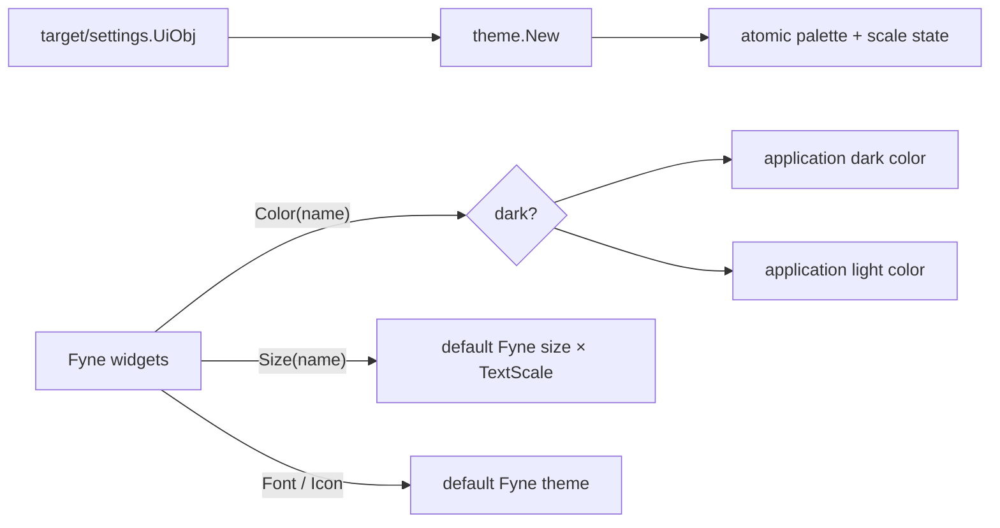

# Theme

Package `theme` implements `fyne.Theme` with the application's light and dark
palettes and a runtime text-size multiplier.

Import path:

```go
import apptheme "github.com/voluminor/dji-rc-joystick/gui/internal/theme"
```

## Resolution flow



Only colors and sizes are customized. Fonts and icons come from Fyne's default
theme, which keeps platform rendering and built-in resources consistent.

## Public API

| API                            | Contract                                                                                      |
|--------------------------------|-----------------------------------------------------------------------------------------------|
| `type Obj`                     | Concurrently mutable implementation of `fyne.Theme`.                                          |
| `New(settings)`                | Initializes dark mode and text scale from `target/settings.UiObj`.                            |
| `(*Obj).SetDark(bool)`         | Selects the dark or light palette.                                                            |
| `(*Obj).IsDark()`              | Returns the current palette selection.                                                        |
| `(*Obj).SetTextScale(float32)` | Clamps and applies the multiplier used for every Fyne theme size.                             |
| `(*Obj).TextScale()`           | Returns the current size multiplier.                                                          |
| `(*Obj).Color(name, variant)`  | Resolves application colors and delegates unknown names to the matching default Fyne variant. |
| `(*Obj).Size(name)`            | Returns `theme.DefaultTheme().Size(name) * TextScale()`.                                      |
| `(*Obj).Font(style)`           | Delegates to Fyne's default theme.                                                            |
| `(*Obj).Icon(name)`            | Delegates to Fyne's default theme.                                                            |

The `variant` argument to `Color` is intentionally ignored. `SetDark` is the
single source of palette state, so a Fyne-provided variant cannot put different
widgets into conflicting modes.

## Example

```go
ui := targetsettings.UiObj{
DarkMode: true,
TextSize: 1.25,
Language: "en",
}

activeTheme := apptheme.New(ui)
application.Settings().SetTheme(activeTheme)

activeTheme.SetDark(false)
activeTheme.SetTextScale(1.5)
application.Settings().SetTheme(activeTheme)
```

Reapplying the theme through `application.Settings().SetTheme` asks Fyne to
refresh existing canvases after a runtime change.

## Validation and concurrency

Palette and scale values are stored atomically. Fyne may call `Color`, `Size`,
`Font`, and `Icon` while UI code updates the theme without creating a data
race.

`New` and `SetTextScale` clamp finite values to the generated settings range
`0.2..8.0`. NaN and infinity use the default scale `1.0`. This keeps direct
callers from injecting values that would break Fyne layout.

The package owns no goroutines, files, native handles, or resources that need
closing.
