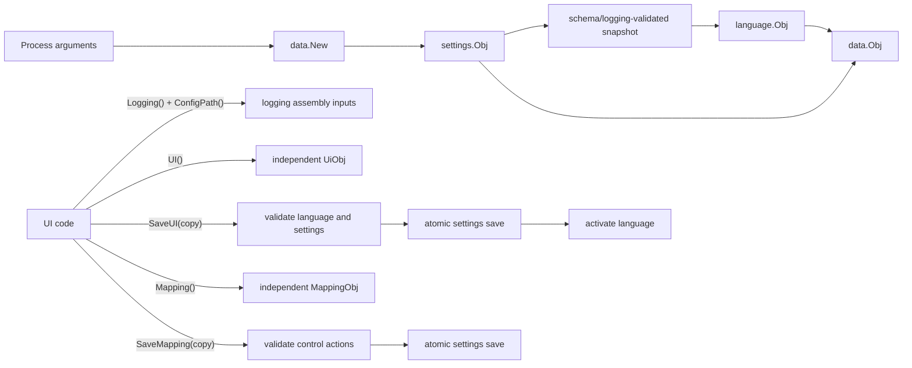

# Data

Package `data` is the application-level facade for persistent settings and
translations. It keeps those services consistent when UI settings change.

Import path:

```go
import "github.com/voluminor/dji-rc-joystick/mod/data"
```

## How it works



`New` loads settings first, then initializes the language selected by those
settings. `SaveUI` checks the requested language, persists the complete UI
snapshot, and only then changes the active translation catalog. A failed save
therefore leaves the in-memory UI and language unchanged.

## Public API

| API                           | Contract                                                                                                          |
|-------------------------------|-------------------------------------------------------------------------------------------------------------------|
| `type Obj`                    | Owns the settings store and active language service.                                                              |
| `New(args)`                   | Loads defaults, the settings file, and CLI overrides. It returns an error without a partially initialized object. |
| `(*Obj).Language()`           | Returns the same concurrency-safe translation service on every call.                                              |
| `(*Obj).ConfigPath()`         | Returns the resolved active settings path used to resolve relative log directories.                               |
| `(*Obj).Logging()`            | Returns an independent `target/settings.LoggingObj` value.                                                        |
| `(*Obj).UI()`                 | Returns an independent `target/settings.UiObj` value. Editing it does not change active settings.                 |
| `(*Obj).SaveUI(ui)`           | Validates, atomically persists, and activates a complete UI snapshot.                                             |
| `(*Obj).Mapping()`            | Returns the complete control mapping as an independent value.                                                     |
| `(*Obj).SaveMapping(mapping)` | Validates control/action compatibility and atomically persists the complete mapping.                              |

The facade deliberately does not expose its settings object. Callers that need
lower-level loading or conversion can use the
[`settings`](settings/README.md) package directly.

## Example

```go
store, err := data.New(os.Args[1:])
if err != nil {
return err
}

ui := store.UI()
ui.Language = "ru-RU"
ui.DarkMode = false
ui.TextSize = 1.25

if err := store.SaveUI(ui); err != nil {
return err
}

title := store.Language().Get("window.title", "DJI RC Joystick")
fmt.Println(title)
```

## Concurrency and ownership

- `Obj`, the returned language service, and the underlying settings store are
  safe for concurrent use.
- `Logging` returns a plain value. UI and mapping saves preserve it unchanged.
- `UI` returns a plain value. No lock remains held after the call.
- `Mapping` returns a plain value whose nested fields contain no shared maps or
  slices.
- `SaveUI` and `SaveMapping` share one save lock, so concurrent writes cannot
  overwrite each other's current settings snapshot.
- Concurrent reads wait only while their underlying service snapshot is being
  copied or committed.
- The returned `*Obj` owns its internal services for its entire lifetime.

## Errors

`New` reports invalid arguments, unreadable or malformed settings, unsupported
formats, validation failures, and persistence errors when a missing settings
file cannot be created.

`SaveUI` rejects unsupported languages and all generated settings validation
failures. Error strings are suitable for wrapping with `%w`; callers should
not match their text.

`SaveMapping` rejects unknown actions, analog/button type mismatches, duplicate
axis targets, and duplicate pinned buttons before writing the settings file.
`New` does not validate loaded mapping action strings. Runtime consumers must
validate the converted `rc.MappingObj`; `rc.New` does this automatically.

Use `Language` for lookup, enumeration, and inspection. Calling
`Language().Set` directly changes only the process language; use `SaveUI` when
the selection must remain consistent with persistent settings.

## Related packages

- [`language`](language/README.md) — translation lookup and fallback behavior.
- [`settings`](settings/README.md) — loading, precedence, snapshots, and
  persistence.
- [`rc`](../rc/README.md) — controller transport and control mapping.
