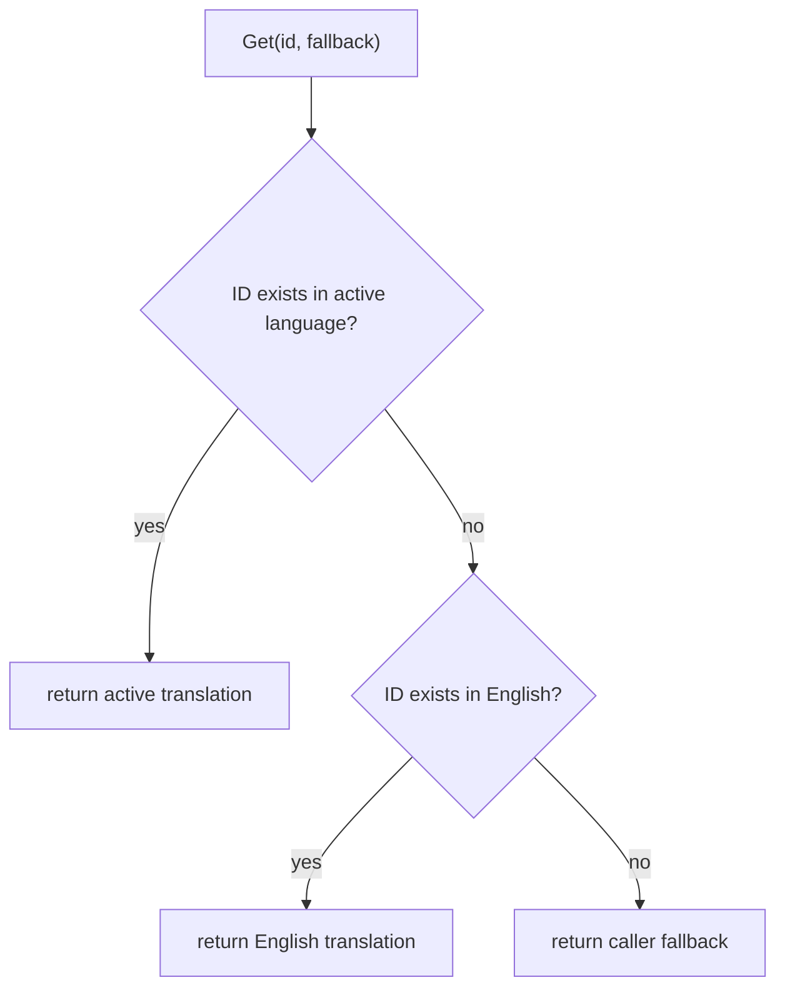

# Language

Package `language` provides a concurrency-safe selector over the embedded,
generated translation catalogs.

Import path:

```go
import "github.com/voluminor/dji-rc-joystick/mod/data/language"
```

It performs no filesystem or network I/O. Translation data is compiled into
`target/language`.

## Lookup behavior



English is the catalog fallback even when another language is active. The
caller-provided string is the final fallback, so UI code always controls what
is displayed for an unknown ID.

## Public API

| API                        | Contract                                                                           |
|----------------------------|------------------------------------------------------------------------------------|
| `ErrKeyEmpty`              | Sentinel returned when a required language key is empty. Use `errors.Is`.          |
| `type OptionObj`           | One selectable language: stable `Key` and display `Name`.                          |
| `type Obj`                 | Holds the active key and provides synchronized access.                             |
| `New(key)`                 | Creates a selector for an embedded language. Empty and unknown keys fail.          |
| `(*Obj).List()`            | Returns a newly allocated list of all supported languages.                         |
| `(*Obj).Supports(key)`     | Reports whether an embedded catalog exists.                                        |
| `(*Obj).Current()`         | Returns the active language key.                                                   |
| `(*Obj).Set(key)`          | Selects another embedded language. A failed call leaves the current key unchanged. |
| `(*Obj).Get(id, fallback)` | Resolves the ID through the active, English, and caller fallbacks.                 |

`OptionObj.Name` is the catalog's native display name, such as `English` or
`Русский`.

## Example

```go
languages, err := language.New("en")
if err != nil {
return err
}

for _, option := range languages.List() {
fmt.Printf("%s: %s\n", option.Key, option.Name)
}

if languages.Supports("ru-RU") {
if err := languages.Set("ru-RU"); err != nil {
return err
}
}

fmt.Println(languages.Get("button.save", "Save"))
```

## Concurrency and allocations

- `Current`, `Set`, and `Get` synchronize access to the active key.
- Embedded catalogs are immutable and shared.
- `Get` does not build an intermediate option list.
- `List` allocates a new slice on every call; callers may mutate it freely.
- `Set` does not invoke callbacks. UI refresh remains the caller's
  responsibility.

## Errors

`New("")` and `Set("")` return `ErrKeyEmpty`. Unsupported non-empty keys return
descriptive errors. `Get` never returns an error because it always has the
caller-provided final fallback.
