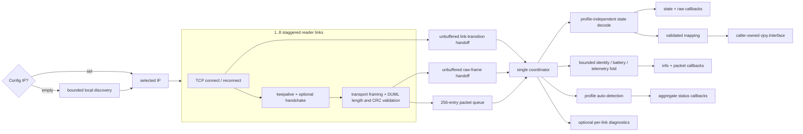
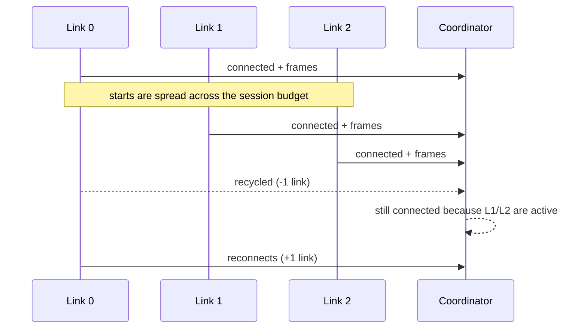

# RC

Package `rc` discovers DJI screen controllers, reads their TCP/DUML stream,
decodes semantic controls, and publishes state to callbacks and an optional
virtual-input sink.

Import path:

```go
import "github.com/voluminor/dji-rc-joystick/mod/rc"
```

The package owns network connections and pipeline goroutines. It does not own
the `vjoy.Interface` supplied by a caller.

## Pipeline



Readers parse independently, but one coordinator owns profile changes,
decoding, sink writes, and callback publication. Consumers therefore see one
ordered stream even when several TCP links overlap.

Each reader forwards the latest RC-channel sample from a parse batch. If one
batch contains several RC-channel frames, the parser retains only the last.
The coordinator publishes every forwarded sample without a timer, rate cap, or
duplicate-state filter.

## Why several links may exist

Some remotes recycle an unauthenticated port-40007 session on a fixed timer.
Profiles can request staggered links so their reconnect windows do not align.



`StatusObj.Phase` reflects stream liveness, not the TCP-link count. It becomes
`PhaseConnected` after a valid controller frame and returns to
`PhaseConnecting` when no valid frame arrives for one second. `LinksOnline` is
the current TCP-link count, and `LinksTarget` is the number of readers started
by the coordinator. A link may remain online while the phase is connecting,
and the phase may remain connected briefly after the last link closes.

## Basic use

This example fixes the profile before creating the virtual device. That keeps
device identity and transport policy explicit:

```go
profile, ok := rc.ProfileByID("rc2")
if !ok {
return errors.New("RC 2 profile is unavailable")
}

mapping := rc.DefaultMapping()
if err := mapping.Validate(); err != nil {
return err
}

device, err := vjoy.New(mapping.DeviceSpec(profile))
if err != nil {
return err
}
defer device.Close()

controller, err := rc.New(rc.ConfigObj{
IP:        "192.168.0.100",
ProfileID: profile.ID,
Mapping:   &mapping,
Sink:      device,
})
if err != nil {
return err
}

controller.OnState(func (state rc.StateObj) {
if state.Pressed(rc.ButtonRTH) {
fmt.Println("RTH pressed")
}
})
controller.OnStatus(func (status rc.StatusObj) {
fmt.Printf(
"%s links=%d/%d rate=%.1f Hz\n",
status.Phase,
status.LinksOnline,
status.LinksTarget,
status.Rate,
)
})

ctx, cancel := signal.NotifyContext(
context.Background(),
os.Interrupt,
)
defer cancel()

if err := controller.Start(ctx); err != nil {
return err
}
defer controller.Stop()

<-ctx.Done()
return nil
```

For auto-detection, leave `ProfileID` empty. A consumer that needs the detected
model's name before creating a virtual device should start with no sink, wait
for a `StatusObj.DeviceID` that `ProfileByDeviceID` recognizes, build the
device from that profile, then call `AttachSink`. An unknown non-empty device
ID is retained in status while the controller keeps its current profile.

`AttachSink(nil)` detaches output without stopping network input. Replacing or
detaching a sink never closes it. The call waits for the current output frame;
after it returns, the old sink is no longer in use and can be closed safely.

## Discovery

```go
ctx, cancel := context.WithTimeout(context.Background(), 10*time.Second)
defer cancel()

remotes, err := rc.Discover(ctx, &rc.DiscoverConfigObj{
CollectInfo: true,
OnProgress: func (progress rc.DiscoverProgressObj) {
fmt.Printf(
"\rnetwork=%s probed=%d/%d found=%d",
progress.Network,
progress.Probed,
progress.Total,
progress.Found,
)
},
})
if err != nil {
return err
}
for _, remote := range remotes {
fmt.Printf("%s %s %s\n", remote.IP, remote.Model, remote.Firmware)
}
```

Discovery first probes known DJI addresses, then eligible local IPv4 subnets.
It skips loopback, link-local, down interfaces, the host's own address, and
networks outside the configured prefix policy. Results are deterministic within
each subnet and deduplicated by IP.

`DiscoverConfigObj` fields:

| Field              | Zero value and limits                                                             |
|--------------------|-----------------------------------------------------------------------------------|
| `Port`             | `DefaultPort` (`40007`); explicit values must be `1..65535`.                      |
| `KnownIPs`         | Built-in DJI addresses; custom lists accept at most 64 valid IP literals.         |
| `BatchSize`        | `64`; explicit values must be `1..256`.                                           |
| `ScanDialTimeout`  | `300 ms`; negative values fail.                                                   |
| `ProbeDialTimeout` | `500 ms`; negative values fail.                                                   |
| `ReadTimeout`      | `500 ms`; negative values fail.                                                   |
| `MaxHosts`         | `1022`; explicit values must be `1..65534`.                                       |
| `MinPrefix`        | `/16`; explicit values must be `16..30`.                                          |
| `CollectInfo`      | `false`; when true, probes request model and firmware.                            |
| `OnProgress`       | `nil`; otherwise receives serialized progress at most 10 Hz plus pass boundaries. |

Cancellation returns the remotes collected so far together with `ctx.Err()`. A
completed scan with no responses returns an empty slice and no error.

`DiscoverProgressObj.Known` distinguishes the initial known-address pass.
`Network` contains the current subnet CIDR during a subnet pass. `Probed` and
`Total` apply to the current pass, while `Found` is cumulative. The callback is
synchronous; keep it short so discovery workers do not wait on presentation
work.

## Profiles and capabilities

The decoder uses one universal wire layout. A `ProfileObj` supplies identity,
transport hints, announced device IDs, and absent controls; it does not replace
the decode algorithm.

Built-in profiles:

| ID    | Model    | Detection                | Transport preference               | Notable capability        |
|-------|----------|--------------------------|------------------------------------|---------------------------|
| `rc`  | DJI RC   | Default; matches `rm330` | Version keepalive, one link        | Camera half-press present |
| `rc2` | DJI RC 2 | Matches `rc331`          | No keepalive, five staggered links | No camera half-press      |

Public profile API:

| API                         | Contract                                                                               |
|-----------------------------|----------------------------------------------------------------------------------------|
| `Profiles()`                | Returns independent copies of every built-in profile.                                  |
| `ProfileByID(id)`           | Resolves a stable profile ID.                                                          |
| `ProfileByDeviceID(id)`     | Resolves an announced remote identity.                                                 |
| `DefaultProfile()`          | Returns the initial RM330 descriptor.                                                  |
| `ProfileObj.Capabilities()` | Returns axis, button, and mode availability.                                           |
| `Obj.Profile()`             | Returns an independent copy of the active profile. It may change after auto-detection. |

`ProfileObj.DeviceIDs` and `AbsentButtons` returned by the package are safe to
mutate; they do not alias pipeline state.

## Controls and state

Semantic axes:

| Constant                          | Meaning                                 |
|-----------------------------------|-----------------------------------------|
| `AxisLeftH`, `AxisLeftV`          | Left stick horizontal and vertical      |
| `AxisRightH`, `AxisRightV`        | Right stick horizontal and vertical     |
| `AxisLeftWheel`, `AxisRightWheel` | Left and right dials                    |
| `AxisCount`                       | Array bound and number of semantic axes |

Axis values in `StateObj.Axes` are scaled to `-32767..32767`.

Semantic buttons are `ButtonRTH`, `ButtonRecord`, `ButtonCameraHalf`,
`ButtonCameraFull`, `ButtonC1`, and `ButtonC2`; `ButtonCount` is their array
bound. `StateObj.Pressed` safely returns false for an invalid ID.

Flight mode values are `ModeSport`, `ModeNormal`, `ModeCinema`, and
`ModeUnknown`. `AxisID`, `ButtonID`, `ModeID`, and `PhaseID` implement `String`
for stable diagnostic labels.

`RawObj` exposes the bounded original RC payload and decoded channel words for
mapping or protocol work. `PacketObj` exposes a bounded DUML payload prefix and
header fields. `PacketObj.IsResponse` and `AckType` decode its command flags.

## Mapping

`MappingObj` maps semantic inputs to action names from `mod/vjoy`:

- `Axes` and `Mode` require continuous actions (`axis_*`, `wheel`, or
  `hwheel`);
- `Buttons` require discrete actions (`button`, `buttonN`, or wheel ticks);
- an empty string or `vjoy.ActionUnmapped` disables a binding;
- `Invert` reverses an axis before axis or wheel conversion.

`Validate` rejects unknown semantic IDs, unknown actions, source/action type
mismatches, duplicate continuous targets, duplicate pinned buttons, and pinned
button numbers outside `1..79`.

`DefaultMapping` creates six joystick axes, one mode slider, and automatic
gamepad buttons. `DeviceSpec(profile)` converts a validated mapping into the
matching `vjoy.SpecObj`.

`rc.New` validates a supplied mapping and copies all maps. The caller may
mutate or discard the original after construction.

`MappingObj.Feed(sink, state)` applies one decoded state to a caller-owned
virtual device. The mapping must already be validated and must remain
immutable until the call returns. This method lets a separate lifecycle owner
keep the virtual device alive while the network controller reconnects.
`Feed` attempts every mapped `Set` and the final `Sync`, then returns the first
error. A held button mapped to a wheel-tick action emits one tick for every
state passed to `Feed`.

## Runtime API and lifecycle

| API                                                  | Contract                                                                                                  |
|------------------------------------------------------|-----------------------------------------------------------------------------------------------------------|
| `New(ConfigObj)`                                     | Normalizes the port and validates the IP, profile, and mapping; it starts no goroutine or socket.         |
| `Start(ctx)`                                         | Starts one run. Nil contexts and concurrent starts fail. A completed object may be started again.         |
| `Stop()`                                             | Cancels the active run, waits for all readers, and is idempotent. The final phase is `PhaseDisconnected`. |
| `AttachSink(sink)`                                   | Replaces or detaches the caller-owned sink and waits for any feed using the old sink.                     |
| `Snapshot()`                                         | Returns the latest `StateObj` and `StatusObj` values.                                                     |
| `Info()`                                             | Returns an independent copy of the latest `InfoObj`.                                                      |
| `OnState`, `OnRaw`, `OnPacket`, `OnInfo`, `OnStatus` | Register persistent synchronous data and aggregate-status callbacks; nil is ignored.                      |
| `OnLink`                                             | Registers debug-oriented per-reader connection diagnostics; nil is ignored.                               |

Callbacks run on the coordinator goroutine, in registration order, without an
internal lock held. They must return quickly and must not call a blocking
operation that depends on the pipeline. The package intentionally does not
spawn an unbounded goroutine per event or maintain an unbounded callback queue.
A slow callback applies backpressure to all readers.

Registrations last for the lifetime of the object and are reused by later
`Start` calls. Registration does not replay the current snapshot.

`InfoObj` contains announced name, optional model and firmware, self-test
state, battery data, and at most 256 distinct telemetry commands. Every
`OnInfo` callback and `Info` caller receives an independent telemetry slice.

`StatusObj` contains merged phase, selected IP, announced device ID,
`LinksOnline`, `LinksTarget`, average published-sample rate since the readers
started, and the current run's discovery-retry and failed-sink-frame count.
Snapshots always contain the latest link counts. Status callbacks are limited
to one per second for partial count and rate updates; stream-liveness changes,
zero-to-nonzero and nonzero-to-zero link transitions, and identity changes are
immediate.

`OnLink` receives `LinkEventObj` with reader `Index`, post-event `Online`
state, `Operation`, and an optional `Error`. Operation names are `connect`,
`read`, `write`, and `disconnect`. This is intentionally lower-level and more
verbose than `OnStatus`; routine user interfaces should use the aggregate
status.

## Keepalive and handshake

`KeepaliveMode` values:

| Value                | Behavior                                                                  |
|----------------------|---------------------------------------------------------------------------|
| `KeepaliveDefault`   | Uses the active profile preference, then falls back to version inquiries. |
| `KeepaliveVersion`   | Sends General Version Inquiry commands.                                   |
| `KeepaliveHeartbeat` | Sends General Heartbeat commands.                                         |
| `KeepaliveOff`       | Sends no periodic command.                                                |

`Handshake` additionally answers recurring RC poll packets. Explicit DUML
acknowledgement requests are answered regardless of `Handshake`.

`QueryInfo` sends one acknowledged version request on the first link. Some
remotes reset that link after replying, so overlapping links cover the gap.
Passive name, battery, self-test, and telemetry collection does not depend on
`QueryInfo`.

## Input validation and resource bounds

The network side is bounded before data reaches consumers:

- advertised transport and DUML lengths are checked before allocation;
- DUML declared length, header CRC-8, and packet CRC-16 must all match;
- a reader keeps a fixed 8 KiB stream buffer;
- raw frames and link transitions use unbuffered handoffs;
- the packet queue has capacity 256;
- one parse batch exposes at most 16 packet headers;
- raw payloads are capped at 64 bytes and packet diagnostics at 32 bytes;
- telemetry retains at most 256 command keys;
- discovery info collection reads at most 64 KiB from a host;
- overlapping links are capped by `MaxConnections` (`8`);
- discovery parallelism, host count, prefix width, and known-address count are
  validated.

These limits prevent a malformed or hostile LAN service from turning an
advertised length, command-key flood, or discovery setting into unbounded
memory or goroutine growth.

## Errors and ownership

Connection failures trigger reconnect attempts with bounded dial time and
delay until the context ends. They do not transfer sink ownership or close the
sink. A frame with one or more sink `Set`/`Sync` errors increments
`StatusObj.Errors` once; processing continues with later frames.

`Start` owns its derived context and goroutines. `Stop` owns their cancellation
and join. The caller owns:

- the parent context;
- every registered callback and any work it performs;
- the configured mapping value after `New` returns;
- every attached `vjoy.Interface`, including closing replaced devices.

See [`vjoy`](../vjoy/README.md) for virtual-device construction and platform
behavior.
