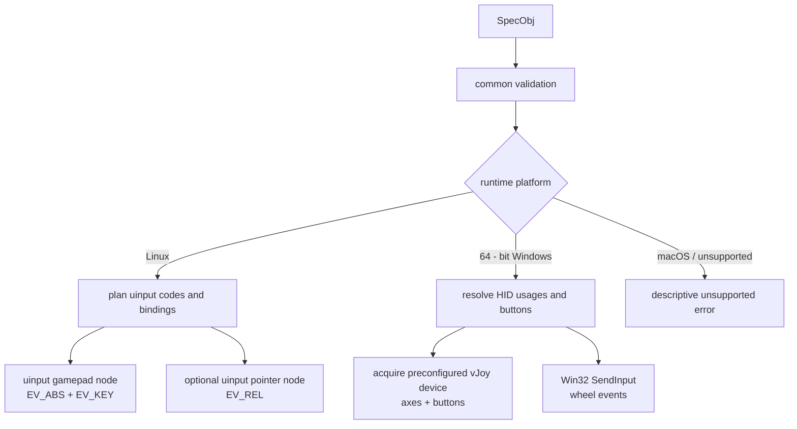
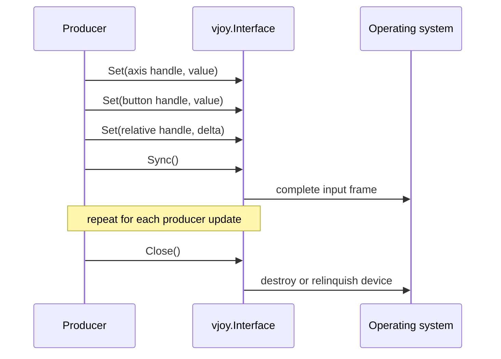

# Virtual input (`vjoy`)

Package `vjoy` turns a platform-neutral device specification into an
operating-system virtual input device.

Import path:

```go
import "github.com/voluminor/dji-rc-joystick/mod/vjoy"
```

The package has no DJI-specific knowledge. A producer defines controls with
stable handles, writes values with `Set`, commits a frame with `Sync`, and
releases native resources with `Close`.

## Architecture



Common validation happens before a backend opens a file, loads a driver DLL,
or acquires a device. Linux completes pure device planning before opening
`/dev/uinput`; Windows resolves every binding before acquiring vJoy.

## Basic use

```go
spec := vjoy.SpecObj{
Name:      "Example Controller",
VendorID:  0x1234,
ProductID: 0x5678,
Controls: []vjoy.ControlObj{
{
Handle: 1,
Kind:   vjoy.KindAxis,
Usage:  vjoy.UsageX,
Min:    -32767,
Max:    32767,
},
{
Handle: 2,
Kind:   vjoy.KindButton,
},
{
Handle: 3,
Kind:   vjoy.KindRelative,
Usage:  vjoy.UsageWheel,
},
},
}

device, err := vjoy.New(spec)
if err != nil {
return err
}
defer device.Close()

if err := device.Set(1, 12000); err != nil {
return err
}
if err := device.Set(2, 1); err != nil {
return err
}
if err := device.Set(3, -1); err != nil {
return err
}
if err := device.Sync(); err != nil {
return err
}
```

Handles are caller-defined addresses. They are independent of slice order,
kernel event codes, vJoy button numbers, and HID usages.

## Public types

### Device specification

| API                | Contract                                                           |
|--------------------|--------------------------------------------------------------------|
| `type SpecObj`     | Device name, optional USB identity, and the complete control list. |
| `type ControlObj`  | Stable `Handle`, `Kind`, `Usage`, and optional axis range.         |
| `type ControlKind` | Output category: button, absolute axis, or relative delta.         |
| `type Usage`       | Semantic axis/wheel selector or a pinned button number.            |
| `New(spec)`        | Validates and creates the platform device.                         |

`ControlKind` values:

| Constant       | `Set` behavior                                                          |
|----------------|-------------------------------------------------------------------------|
| `KindButton`   | Zero releases; any non-zero value presses. `Min` and `Max` are ignored. |
| `KindAxis`     | Value is clamped to `[Min, Max]`.                                       |
| `KindRelative` | Value is emitted as a wheel delta for the current frame.                |

Axis usages are `UsageX`, `UsageY`, `UsageZ`, `UsageRX`, `UsageRY`,
`UsageRZ`, `UsageSlider0`, and `UsageSlider1`. `UsageAuto` assigns the next
axis in that order and is valid only for `KindAxis`. It does not skip usages
selected explicitly; a collision is rejected.

Relative controls accept `UsageWheel` and `UsageHWheel`.

For `KindButton`, `Usage(0)` selects the next free button. A positive usage
pins the 1-based button number.

### Device interface

```go
type Interface interface {
Set(handle uint16, value int32) error
Sync() error
Close() error
}
```

`Set` rejects an unknown handle. `Sync` ends one logical producer frame.
`Close` releases native resources and may be called more than once.
Implementations are not safe for concurrent method calls; the caller must
serialize `Set`, `Sync`, and `Close`.

The package emits no goroutines and keeps no background queue.

## Action vocabulary

Actions are stable configuration strings that describe how a producer input
should become a `ControlObj`.

Discrete actions:

| Constant            | String         | Meaning                                   |
|---------------------|----------------|-------------------------------------------|
| `ActionUnmapped`    | `unmapped`     | Disable the binding                       |
| `ActionButton`      | `button`       | Next free gamepad button                  |
| `ActionButtonN(n)`  | `buttonN`      | Pin button `N`; accepted range is `1..79` |
| `ActionWheelUp`     | `wheel_up`     | One upward vertical-wheel tick            |
| `ActionWheelDown`   | `wheel_down`   | One downward vertical-wheel tick          |
| `ActionHWheelLeft`  | `hwheel_left`  | One leftward horizontal-wheel tick        |
| `ActionHWheelRight` | `hwheel_right` | One rightward horizontal-wheel tick       |

Continuous actions:

| Constant        | String         | Meaning                                                          |
|-----------------|----------------|------------------------------------------------------------------|
| `ActionAxisX`   | `axis_x`       | X axis                                                           |
| `ActionAxisY`   | `axis_y`       | Y axis                                                           |
| `ActionAxisZ`   | `axis_z`       | Z axis                                                           |
| `ActionAxisRX`  | `axis_rx`      | Rotational X axis                                                |
| `ActionAxisRY`  | `axis_ry`      | Rotational Y axis                                                |
| `ActionAxisRZ`  | `axis_rz`      | Rotational Z axis                                                |
| `ActionSlider0` | `axis_slider0` | First slider                                                     |
| `ActionSlider1` | `axis_slider1` | Second slider                                                    |
| `ActionWheel`   | `wheel`        | Analog deflection converted by the producer to vertical deltas   |
| `ActionHWheel`  | `hwheel`       | Analog deflection converted by the producer to horizontal deltas |

`Action(name)` returns the corresponding `ActionObj` and whether the name is
valid. `ActionUnmapped` is valid and returns the zero descriptor. Dynamic
`buttonN` values are parsed and range-checked there.

`ActionButtonN` only formats a string; call `Action` to validate an arbitrary
number. `ActionNames` returns a sorted, newly allocated list of fixed names and
does not enumerate dynamic button numbers.

`ActionObj.Continuous` tells mapping code whether an analog or discrete source
is required. `Kind` and `Usage` describe the target control. `Press` is the
value emitted while a discrete source is active.

## Specification validation

`New` rejects:

- an empty name, a name longer than 79 bytes, invalid UTF-8, or a NUL byte;
- more than 256 declared controls;
- duplicate handles;
- an unknown `ControlKind`;
- an axis with `Min >= Max`;
- non-axis usage on an axis;
- more `UsageAuto` axes than the eight canonical slots;
- two controls targeting the same absolute axis;
- relative controls not using `UsageWheel` or `UsageHWheel`;
- a pinned button outside `1..79`;
- two controls pinned to the same button;
- more than 79 automatic and pinned buttons combined.

Automatic buttons fill the lowest unused numbers in declaration order. The
device advertises buttons through the highest assigned number, so pinned gaps
remain stable instead of being compacted differently by consumers.

The 79-button cap is shared across platforms. Linux supplies 16
`BTN_JOYSTICK` and 63 `BTN_TRIGGER_HAPPY` codes; the `BTN_GAMEPAD` block is
deliberately avoided because SDL applies a semantic gamepad remapping to it.

## Frame lifecycle



Call `Sync` after all values for one producer update. Do not defer `Sync`
across unrelated state updates. Relative deltas represent events, not retained
state, and should be sent only when movement is intended.

## Linux backend

Linux uses `/dev/uinput`.

- The main node carries absolute axes and joystick buttons.
- A second pointer node is created when relative wheel controls exist, keeping
  `EV_REL` off the gamepad node.
- The pointer node also advertises `REL_X`, `REL_Y`, and `BTN_LEFT` for input
  classification. Those extra controls are never bound or emitted.
- `Set` writes input events and `Sync` emits `SYN_REPORT` to every node.
- `Close` issues `UI_DEV_DESTROY` and closes each file.
- Creation pauses for 200 ms after each node.

The process needs write access to `/dev/uinput`. A typical rule is:

```udev
KERNEL=="uinput", GROUP="input", MODE="0660"
```

## Windows backend

The 64-bit Windows backend combines two APIs:

- axes and buttons use an installed, enabled, preconfigured vJoy device;
- wheel actions use Win32 `SendInput`, because vJoy has no relative wheel.

`SendInput` injects wheel events into the Windows input stream; they are not
part of the acquired vJoy device.

The backend scans vJoy device IDs `1..16` and acquires the first free device
with every requested axis and enough buttons. Configure it beforehand with
`vJoyConf`.

vJoy owns device identity, so `SpecObj.Name`, `VendorID`, and `ProductID` do
not change the preconfigured Windows device. Axis ranges are scaled onto
vJoy's fixed `0x1..0x8000` range. Axis/button writes and `SendInput` are
immediate, so `Sync` is a no-op. `Close` relinquishes the acquired device.

The backend builds for Windows amd64 and arm64. Windows 386 is unsupported.

## macOS and other platforms

`New` returns an unsupported-platform error on macOS and other platforms
without a backend. Windows 386 also uses this path.

## Ownership, errors, and cleanup

The caller owns the returned `Interface` and must call `Close`. On creation
failure, the package closes or relinquishes every resource it acquired before
returning.

Backend errors include the failed operation and available native context. A
failed `Set` or `Sync` does not close the device automatically; the caller
decides whether to retry, replace, or close it.

For DJI control mapping and sink ownership, see [`rc`](../rc/README.md).
